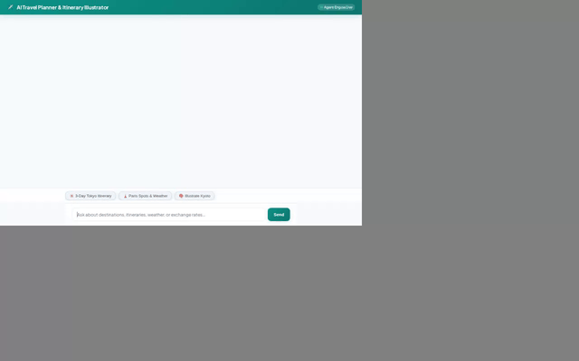

# AI Travel Planner & Itinerary Illustrator ✈️

An intelligent, full-stack agentic travel companion built with the **Google Agent Development Kit (ADK)** and deployed on **Google Agent Platform (Reasoning Engines)**.



---

## 🌟 Key Features & Implemented Capabilities

The agent is powered by **Gemini 2.5 Flash** as its core reasoning engine, combined with a suite of integrated Google Cloud services and specialized tools:

* **🧠 Cross-Session Long-Term Memory**: Integrated with **Vertex AI Memory Bank** to automatically retain user travel preferences, favorite destinations, and budget constraints across sessions.
* **🗄️ Firestore Travel Database**: Queries and updates a structured Cloud Firestore database containing destination information, budget estimates, best times to visit, and highlights.
* **🎨 AI Travel Illustration Generation**: Generates custom travel artwork using **`gemini-3.1-flash-lite-image`** and **`gemini-2.5-flash-image`**, saving image artifacts and uploading them to public **Google Cloud Storage** buckets.
* **📹 AI Short Video Clip Generation**: Creates short video clips of travel landmarks and spots using Google's **`gemini-omni-flash-preview`** model in the `global` region via the Vertex AI Interactions API.
* **🗺️ Location & Mapping Tools**:
  * **Geocoding**: Converts place names and landmarks to latitude/longitude coordinates using the **Google Geocoding API**.
  * **Nearby Search**: Discovers nearby attractions, cafes, and museums using the **Google Places API (New)**.
* **💱 Live Currency Exchange Rates**: Retrieves live currency exchange rates via the Frankfurter API to calculate travel budgets.
* **🃏 Rich A2UI Interface**: Emits **A2UI (v0.8)** cards, columns, and image elements for rich UI display.
* **💻 Sandboxed Code Execution**: Executes custom data processing and math scripts inside an **Agent Engine Sandbox Code Executor**.

---

## 🏗️ Architecture & Cloud Infrastructure

* **Agent Engine**: Google Agent Platform (Reasoning Engine) running ADK agent runtime.
* **Memory Service**: Vertex AI Memory Bank (`VertexAiMemoryBankService`).
* **Database**: Google Cloud Firestore (`destinations` collection).
* **Media Storage**: Google Cloud Storage public media bucket.
* **Frontend**: Custom FastAPI proxy + responsive chat interface featuring theme styling, prompt chips, and avatar dialogue bubbles.

---

## 🚀 Local Setup & Instructions

### Prerequisites
* Python 3.10+
* Google Cloud SDK (`gcloud`) authenticated with a GCP project containing Vertex AI and Firestore permissions.

### Installation

1. **Clone the repository and install dependencies**:
   ```bash
   pip install -r requirements.txt
   pip install -r frontend/requirements.txt
   ```

2. **Configure Environment Variables**:
   Set your Google Maps API key in `.env` or in your terminal shell:
   ```bash
   export GOOGLE_MAPS_API_KEY="YOUR_API_KEY"
   ```

3. **Run the Agent in ADK Playground**:
   ```bash
   adk web . --port 8080 --reload_agents
   ```

4. **Run the Custom FastAPI Frontend Proxy**:
   Navigate to the `frontend/` directory and launch the server:
   ```bash
   cd frontend
   export AGENT_ENGINE_RESOURCE_NAME="projects/<project-id>/locations/<location>/reasoningEngines/<engine-id>"
   export AGENT_DIRECTORY="app"
   python main.py
   ```
